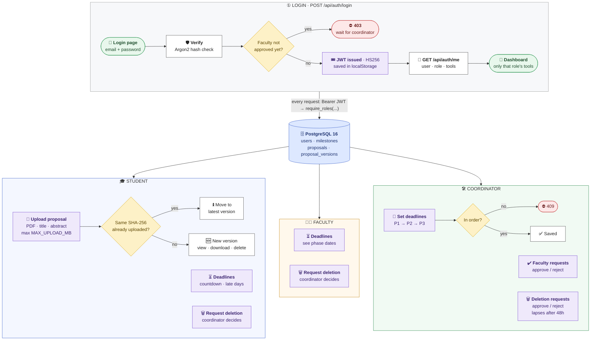

# ThesisFlow
A Thesis platform project for CSE470-bracu

Stack: FastAPI + SQLAlchemy + Alembic, PostgreSQL 16 (pgvector), React + Vite + Tailwind. See `470_srs_g7.pdf`.

## Features so far

- Accounts: register / log in (JWT), password strength check, role-based tools on the dashboard.
- Faculty approval: new faculty wait for coordinator approval.
- Account deletion: request + coordinator approval, 48-hour lapse.
- Deadlines: coordinator sets a deadline per phase (phase deadlines must stay in order: none before an earlier phase's or after a later one's); students see a countdown, on-time / late status and late days.
- Proposals: students upload PDF versions (max `MAX_UPLOAD_MB`, default 20 MB) and delete them. Re-uploading an identical file (same sha256) moves it to the latest version instead of storing a copy.

## How it works



## Run

Needs Docker only.

```bash
cp .env.example .env          # optional, defaults work for dev
docker compose up --build
docker compose exec backend python -m app.seed   # dev student + faculty, password: password123
```

- App: http://localhost:5173 (log in as `student@thesisflow.test` or `faculty@thesisflow.test`; coordinator is `ADMIN_EMAIL` / `ADMIN_PASSWORD`, default `coordinator@thesisflow.test` / `password123`)
- Sign-up: students can log in right away. Faculty wait for the coordinator to approve them under "Faculty requests". There is no coordinator sign-up; the one coordinator account is created/updated from `ADMIN_EMAIL` / `ADMIN_PASSWORD` when the backend starts.
- Account deletion: students and faculty request it under "Account". The coordinator approves or rejects it under "Deletion requests"; a request not approved within 48 hours lapses and the account is kept. The coordinator account cannot be deleted.
- API docs: http://localhost:8000/docs
- Tests: `docker compose exec backend pytest`

## Layout (MVC)

```
backend/app/
  models/       Model: SQLAlchemy tables
  services/     Model: business rules
  controllers/  Controller: FastAPI routers (check user, call a service, nothing else)
  schemas/      Pydantic request/response shapes
  deps.py       get_current_user, require_roles(...)
backend/alembic/versions/   DB migrations
backend/tests/              pytest
frontend/src/
  pages/        View: one file per page (RequestsPage = faculty + deletion requests)
  components/   View: Layout (auth guard + nav), ui.jsx (Logo, PageHeader, Alerts)
  api/client.js fetch wrapper (adds JWT)
  useAction.js  busy / error / success state for a page's API calls
  tools.jsx     nav + dashboard entry for each tool key the API returns in user.tools
  format.js     shared display formatting
```

**Rule: logic lives in the backend.** The frontend only shows what the API returns and sends what the user typed. Validation, permissions, status changes, calculations, filtering, sorting, and "can this user do X" checks all go in `services/`. If a page needs a derived value or a flag (e.g. `can_submit`), the API returns it. The frontend never decides it.

## Adding a feature

Example for proposals (F11):

1. `backend/app/models/proposal.py` — table. Import it in `models/__init__.py`.
2. `docker compose exec backend alembic revision --autogenerate -m "proposals"`, check the file, then `alembic upgrade head`.
3. `backend/app/schemas/proposal.py` — request/response models.
4. `backend/app/services/proposal_service.py` — the rules.
5. `backend/app/controllers/proposal_controller.py` — router with `prefix="/api/proposals"`. Add it in `main.py`.
6. `backend/tests/test_proposals.py`.
7. `frontend/src/pages/ProposalPage.jsx` and a route in `App.jsx`.

Protect an endpoint by role:

```python
from app.deps import require_roles
from app.models.user import Role, User

@router.post("")
def create(user: User = Depends(require_roles(Role.coordinator)), db: Session = Depends(get_db)): ...
```

Roles are `student`, `faculty`, `coordinator`. Supervisor and panel member are per-group / per-defense links to a faculty user, not account roles.

## Git workflow

- Branch off `main`: `feature/<short-name>` (e.g. `feature/proposal-upload`).
- Open a PR into `main`. CI runs backend tests and the frontend build.
- Two people adding migrations at once makes two Alembic heads. After pulling, if `alembic heads` shows more than one, set your migration's `down_revision` to the other head.
