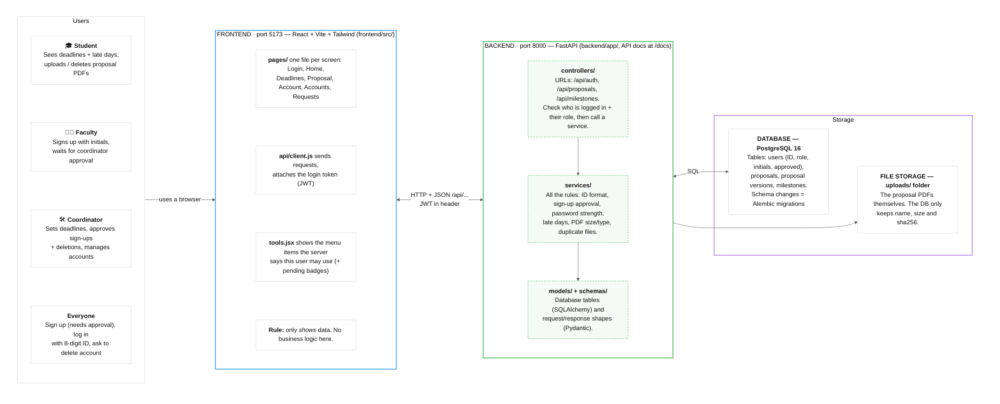

# ThesisFlow

A web platform for running undergraduate theses, built for CSE470 (Software Engineering) at BRAC University.

ThesisFlow brings the thesis process into one place: students submit their proposals and track deadlines, faculty sign up and review work, and a single coordinator runs the course (approves sign-ups, sets phase deadlines, handles account deletions). The full requirements are in `470_srs_g7.pdf`.

**Stack:** FastAPI + SQLAlchemy + Alembic, PostgreSQL 16 (pgvector), React + Vite + Tailwind, all run with Docker Compose.

## Architecture



**Example — a student uploads a proposal PDF:**

1. Student picks a file on the **Proposal page**.
2. **client.js** sends `POST /api/proposals/mine/versions` + token.
3. **Controller** checks: logged in? a student?
4. **Service** checks PDF + size, saves the file, adds a version row.
5. Server replies with JSON; the page shows the new version list.

Run everything with `docker compose up` — it starts 3 containers: **frontend**, **backend**, **db**. Secrets + coordinator account come from `.env` (no defaults). Tests: `pytest` in `backend/tests/`.

## Getting started

You only need [Docker](https://www.docker.com/) (with Docker Compose).

```bash
git clone https://github.com/ironMan-blip/ThesisFlow.git && cd ThesisFlow
cp .env.example .env                              # required: fill in every value
docker compose up --build                         # starts db, backend and frontend
docker compose exec backend python -m app.seed    # optional: adds a dev student and faculty
```

On start, the backend runs the database migrations (`alembic upgrade head`) and creates or updates the coordinator account.

| What | Where |
|------|-------|
| Web app | http://localhost:5173 |
| API docs (Swagger) | http://localhost:8000/docs |
| Tests | `docker compose exec backend pytest` |
| Database shell | `docker compose exec db psql -U thesisflow` |

### Dev logins

| Role | ID number | Password |
|------|-----------|----------|
| Student (seed) | `10000001` | `SEED_PASSWORD` |
| Faculty (seed) | `20000001` | `SEED_PASSWORD` |
| Coordinator | `ADMIN_ID_NUMBER` | `ADMIN_PASSWORD` |

### Configuration (`.env`)

Sensitive values have no defaults. The backend and `docker compose` refuse to start if one is missing.

| Variable | Default | Meaning |
|----------|---------|---------|
| `POSTGRES_USER` | required | Database user. Used to build `DATABASE_URL` in Docker. |
| `POSTGRES_PASSWORD` | required | Database password. Only applied when the db volume is first created. |
| `JWT_SECRET` | required | Secret used to sign login tokens. |
| `ADMIN_NAME` | required | Coordinator display name. Set again on every backend start. |
| `ADMIN_EMAIL` | required | The one coordinator account. |
| `ADMIN_ID_NUMBER` | required | Coordinator login ID. Set again on every backend start. |
| `ADMIN_PASSWORD` | required | Coordinator password. Set again on every backend start. |
| `SEED_PASSWORD` | none | Password for the seed accounts. Only `app.seed` needs it. |
| `MAX_UPLOAD_MB` | `20` | Largest proposal PDF allowed. |
| `JWT_EXPIRE_MINUTES` | `1440` | How long a login lasts (24 hours). |

## Features

There are three roles. Each one sees only its own tools in the navigation and on the dashboard; the API decides which tools a user gets.

| Role | Tools |
|------|-------|
| Student | Proposal, Deadlines, Account |
| Faculty | Deadlines, Account |
| Coordinator | Deadlines, Accounts, Registration requests, Deletion requests |

Tools with waiting work (registration or deletion requests) show a count badge in the nav and on the dashboard. The nav is a fixed sidebar on desktop and a slide-out drawer on phones.

Supervisor and panel member are not account roles. They will be links between a faculty user and a group or defense.

### 1. Accounts and login

- Register with full name, email, a 8-digit ID number and password, as a **student** or **faculty**. Nobody can sign up as coordinator.
- Faculty must also give their **initials** (1 to 10 capital letters, e.g. `ABK`), unique across faculty.
- Password rules: 8 to 128 characters, at least one uppercase letter, one lowercase letter and one number, no spaces.
- Emails are case-insensitive (stored lowercase) and must be unique.
- ID numbers are exactly 8 digits and must be unique across students and faculty. Log in with ID number and password.
- Login returns a JWT (valid 24 hours by default). The frontend sends it with every request.
- **Coordinator account:** there is exactly one. It is created from `ADMIN_NAME` / `ADMIN_EMAIL` / `ADMIN_ID_NUMBER` / `ADMIN_PASSWORD` when the backend starts, and its password is reset to `ADMIN_PASSWORD` if it changed.

### 2. Registration approval

- Every new account (student or faculty) starts **unapproved** and cannot log in. Login shows "waiting for coordinator approval".
- The coordinator sees all waiting sign-ups under **Registration requests** and approves or rejects each one.
- Rejecting deletes the request, so that email can register again.
- Registering again with the same email while the request is still waiting is refused. If the coordinator has not decided within **48 hours**, a new sign-up replaces the old request.

### 3. Account deletion

- Students and faculty can ask to delete their account under **Account**. The account keeps working while the request waits.
- The coordinator approves or rejects it under **Deletion requests**.
- A request not approved within **48 hours** lapses and the account is kept.
- Approving deletes the user, their proposal, all its versions and the stored PDF files.
- The coordinator account cannot be deleted.

### 4. Account management (coordinator)

- **Accounts** lists every approved student and faculty account, with Students / Faculty tabs and a search by ID number prefix. Waiting sign-ups and the coordinator account are not listed.
- The coordinator can delete any listed account directly. This removes the user, their proposal, all versions and the stored PDF files.

### 5. Deadlines (phases P1, P2, P3)

- The thesis has three phases: **P1, P2, P3**. The coordinator sets, for each phase:
  - a **due date and time** (time defaults to 11:59 PM),
  - a **grace period** in days (0 to 7),
  - a **late penalty** in percent per day (0 to 100).
- Phase deadlines are independent: any phase can be due before or after another (dates will vary per semester and group).
- Everyone sees each phase's status: **not set**, **open**, **in grace**, or **closed**, with a live countdown ("Due in" while open, "Grace ends in" during grace).
- Students also see, per phase, their own submission status:
  - **on time**, **late**, or **not submitted**,
  - **late days**: uploads during the grace period are accepted but late; every started day after the due date counts as a full day, and keeps counting until they submit or the grace period ends,
  - **penalty**: late days × penalty per day, capped at 100%.
- The latest upload for a phase is the one that counts.

### 6. Proposal submission

- Students can upload only for phases whose timeline is set and whose grace period has not ended; once it ends, uploads for that phase are closed.
- A student who misses a phase (its grace period ends with no upload from them) cannot upload for any later phase (P1 → P2 → P3, whatever the dates) until the next semester's deadlines are set.
- Students upload a proposal version with a **phase** (P1/P2/P3), **title** (1 to 255 characters), **abstract** and a **PDF file**.
- The file must really be a PDF (checked by its content, not its name) and at most `MAX_UPLOAD_MB` (20 MB by default).
- Every upload becomes a new numbered version (v1, v2, …). The page lists all past versions, newest first, with a download link.
- Re-submitting the exact same PDF with the same title and abstract does not store a copy: that existing version moves to the top as the latest.
- Students can delete a version (with a confirmation dialog) until its phase's grace period ends; after that it is final and the Remove button is hidden. Later versions shift down so numbers stay in order, and the PDF file is removed.
- Students see only their own proposal. Faculty and the coordinator can download any version (for review).
- Uploads and deletes by the same student are locked against each other, so version numbers never clash.

## Project layout (MVC)

```
backend/app/
  models/       Model: SQLAlchemy tables (User, Milestone, Proposal, ProposalVersion)
  services/     Model: business rules
  controllers/  Controller: FastAPI routers (check user, call a service, nothing else)
  schemas/      Pydantic request/response shapes
  deps.py       get_current_user, require_roles(...)
  seed.py       dev student + faculty
backend/alembic/versions/   DB migrations
backend/tests/              pytest
frontend/src/
  pages/        View: one file per page (RequestsPage = registration + deletion requests, AccountsPage = coordinator account list)
  components/   View: Layout (auth guard + sidebar nav, drawer on phones), ui.jsx (Icon/ICONS, Logo, PageHeader,
                Skeleton, Alerts, Avatar, Person, EmptyState, CountBadge)
  api/client.js fetch wrapper (adds JWT)
  useAction.js  busy / error / success state for a page's API calls
  tools.jsx     nav + dashboard entry for each tool key the API returns in user.tools
  format.js     shared display formatting
```

**Rule: logic lives in the backend.** The frontend only shows what the API returns and sends what the user typed. Validation, permissions, status changes, calculations, filtering, sorting, and "can this user do X" checks all go in `services/`. If a page needs a derived value or a flag (e.g. `can_edit`), the API returns it. The frontend never decides it.

### API overview

| Method | Path | Who |
|--------|------|-----|
| POST | `/api/auth/register` | anyone |
| POST | `/api/auth/login` | anyone |
| GET | `/api/auth/me` | logged in |
| POST | `/api/auth/me/deletion-request` | student, faculty |
| GET | `/api/auth/me/counts` (pending-request badges per tool) | logged in |
| GET / DELETE | `/api/auth/accounts[/{id}]` (`?role=&id_prefix=` filters) | coordinator |
| GET / POST / DELETE | `/api/auth/registration-requests[/{id}[/approve]]` | coordinator |
| GET / POST / DELETE | `/api/auth/deletion-requests[/{id}[/approve]]` | coordinator |
| GET | `/api/milestones` | logged in |
| PUT | `/api/milestones/{phase}` | coordinator |
| GET | `/api/proposals/mine` | student |
| POST | `/api/proposals/mine/versions` | student |
| DELETE | `/api/proposals/versions/{id}` | student (own) |
| GET | `/api/proposals/versions/{id}/file` | owner, faculty, coordinator |

Full request/response shapes are at http://localhost:8000/docs.

## Adding a feature

Example for proposals (F11):

1. `backend/app/models/proposal.py` — table. Import it in `models/__init__.py`.
2. `docker compose exec backend alembic revision --autogenerate -m "proposals"`, check the file, then `alembic upgrade head`.
3. `backend/app/schemas/proposal.py` — request/response models.
4. `backend/app/services/proposal_service.py` — the rules.
5. `backend/app/controllers/proposal_controller.py` — router with `prefix="/api/proposals"`. Add it in `main.py`.
6. `backend/tests/test_proposals.py`.
7. `frontend/src/pages/ProposalPage.jsx`, a route in `App.jsx`, and a tool entry in `tools.jsx` + `ROLE_TOOLS` in `models/user.py`.

Protect an endpoint by role:

```python
from app.deps import require_roles
from app.models.user import Role, User

@router.post("")
def create(user: User = Depends(require_roles(Role.coordinator)), db: Session = Depends(get_db)): ...
```

## Git workflow

- Branch off `main`: `feature/<short-name>` (e.g. `feature/proposal-upload`).
- Open a PR into `main`. CI runs backend tests and the frontend build.
- Two people adding migrations at once makes two Alembic heads. After pulling, if `alembic heads` shows more than one, set your migration's `down_revision` to the other head.
